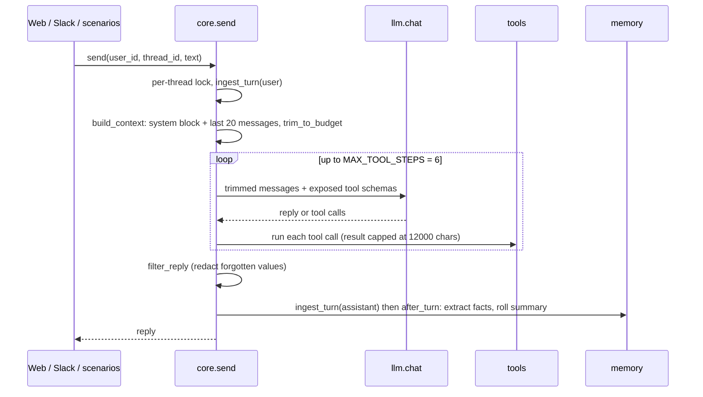

# Architecture

## Components

| Component | File | Role |
| --- | --- | --- |
| Core | [`chatbot/core.py`](https://github.com/marcotgs/simple-chatbot/blob/main/chatbot/core.py) | `send()`, `ingest_turn()`, context building, `trim_to_budget()`, tool loop, tool registry |
| LLM client | [`chatbot/llm.py`](https://github.com/marcotgs/simple-chatbot/blob/main/chatbot/llm.py) | The only module that calls the model. Budget check before and after each call, `llm_calls` + `calls.jsonl` log |
| Storage | [`chatbot/db.py`](https://github.com/marcotgs/simple-chatbot/blob/main/chatbot/db.py) | Per-thread SQLite connection (WAL), forward-only `MIGRATIONS` tracked by `PRAGMA user_version` |
| Config | [`chatbot/config.py`](https://github.com/marcotgs/simple-chatbot/blob/main/chatbot/config.py) | Env vars, plus an optional git-ignored `.env` (real env vars win) |
| Memory | [`chatbot/memory/`](https://github.com/marcotgs/simple-chatbot/tree/main/chatbot/memory) | Facts, extraction, salience gate, summaries, FTS retrieval, doc notes, forget, memory tools. See [[Memory model|Memory-model]] |
| Capabilities | [`chatbot/capabilities/`](https://github.com/marcotgs/simple-chatbot/tree/main/chatbot/capabilities) | `docs`, `linkedin`, `messaging`, loaded on demand. See [[Capabilities guide|Capabilities-guide]] |
| Web server | [`chatbot/server.py`](https://github.com/marcotgs/simple-chatbot/blob/main/chatbot/server.py) | Stdlib `ThreadingHTTPServer`: `GET /`, `/healthz`, `/threads`, `/history`, `POST /send` |
| Web page | [`web/index.html`](https://github.com/marcotgs/simple-chatbot/blob/main/web/index.html) | Vanilla JS chat page, no build step |
| Slack bot | [`chatbot/slack_app.py`](https://github.com/marcotgs/simple-chatbot/blob/main/chatbot/slack_app.py) | Socket Mode: DMs, `/bot`, @mentions, file uploads. See [[Slack setup|Slack-setup]] |
| Uploads | [`chatbot/uploads.py`](https://github.com/marcotgs/simple-chatbot/blob/main/chatbot/uploads.py) | Download a Slack file, extract text (txt/md/csv/json/pdf), store it as a per-user doc |

Every entry point calls `core.send`. The web server defaults to user `user-1`
(`server.DEFAULT_USER`): `POST /send` accepts an optional `user_id`, while `/threads` and `/history`
always show `user-1`. The Slack bot maps the owner's Slack member ID to the same user and uses
its current Slack thread (`slack-dm`, then `slack-dm-2`, ... after each `/bot new`), so the web page
shows the Slack conversation too.

Server guards: `POST /send` needs `Content-Type: application/json` (else 415) and a body up to
64 KB. The `Host` header must be loopback on the bound port or listed in `ALLOWED_HOSTS` (else 403),
and an `Origin` header must match it. With `WEB_TOKEN` set, every route except `/` and `/healthz`
needs `X-Web-Token` or `?token=`. The server refuses to start on a non-loopback `HOST` without
`WEB_TOKEN`.

## Request flow: `core.send`



Step by step:

1. Empty text raises `ValueError`. A per-`(user_id, thread_id)` lock serialises turns in one
   thread; different threads run in parallel.
2. `ingest_turn(user, ...)` stores the message in `messages` (a trigger indexes it in
   `messages_fts`) and opens a new `turn_no`.
3. `build_context` puts everything system into **one** first message: `SYSTEM_PROMPT` + the
   capability index + `memory.memory_text()` (facts, chat summary, docs noted in this thread).
   Then it adds the last `RECENT_TURNS = 20` messages and calls `trim_to_budget` (see [[Token budget|Token-budget]]).
4. `run_tool_loop` calls the model through `_chat_trimmed`. Tools without a capability are always
   sent. A capability's tools are sent only after `load_capability(name)` succeeded in this same
   `send`. A call to a tool whose capability is not loaded gets an error result telling the model
   to load it first.
5. Tool errors go back to the model as `error: ...` strings, never up to the user. After a
   successful `forget`, every message of the loop is redacted and the system block is rebuilt.
6. After 6 steps the model gets one last call without tools, so the user still gets an answer.
7. On `llm.BudgetExceeded` the user message is deleted again (no orphan turn) and the error is
   raised: the server answers 413, Slack answers with a short "too long" message.
8. The reply is redacted with `memory.filter_reply`, stored with `ingest_turn(assistant, ...)`,
   which runs `memory.after_turn` (fact extraction + summary roll) before `send` returns. Memory
   failures are logged and never break the reply.

## SQLite tables

Schema: [`chatbot/db.py`](https://github.com/marcotgs/simple-chatbot/blob/main/chatbot/db.py)
(`MIGRATIONS`; append new entries, never edit applied ones). Default file `data/chatbot.db`
(`DB_PATH`).

| Table | Holds |
| --- | --- |
| `messages` + `messages_fts` | Every user and assistant message with `turn_no`; FTS5 index kept in sync by triggers |
| `facts` | `subject` (the key), `value`, `scope` (global/session/ephemeral), `superseded_by`, `valid_to`, `source_turn` |
| `summaries` | One rolling summary per thread, `upto_turn` |
| `doc_notes` | Per-page `summary` and `key_fact` rows per user and document |
| `memory_cursor` | Last `turn_no` fed to the fact extractor, per thread |
| `forgotten` | Forget tombstones: HMAC digest + token count, never plaintext |
| `llm_calls` | One row per model call: purpose, model, estimated and provider tokens, `usage_missing`, `over_limit` |
| `send_log` | Messages "sent" by the `send_message` tool (logged, never delivered) |
| `settings` | Small key/value state: the Slack session counter per user (`/bot new`) |

## File layout

```
chatbot/            core, llm, db, config, server, slack_app, uploads
chatbot/memory/     facts, extract, gate, summary, retrieval, doc_notes, forget, tools, _llm
chatbot/capabilities/  __init__ (registry), docs, linkedin, messaging
web/index.html      chat page
docs/               seeded synthetic documents + _manifest.json (scripts/gen_docs.py)
scenarios/          S1-S7 runner, checks, LinkedIn rule checker, data/ (generated history)
scripts/            gen_docs.py, gen_history.py
tests/              offline unit and integration tests; live tests opt in with RUN_LIVE_TESTS=1
.githooks/          pre-commit, commit-msg, pre-push (enable with make hooks)
data/, logs/        runtime state (git-ignored): chatbot.db, uploads/, forget.key, calls.jsonl
```
